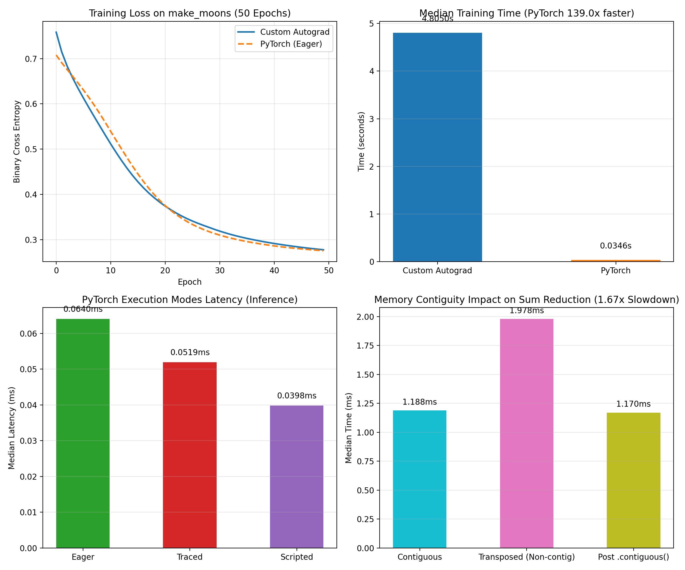

# Lab 5: Frameworks and Automatic Differentiation

## 1. Goal
The objectives of this lab are:
1. Design and build a scalar automatic differentiation engine (`Value` node) supporting dynamic computation graph creation.
2. Implement core operations: addition, multiplication, powers, and ReLU.
3. Implement backward propagation using topological sorting and gradient accumulation.
4. Verify computed gradients against PyTorch autograd and finite-difference numerical gradients on `((a * b + c) ** 2).relu().sum()`, requiring max absolute difference $< 10^{-6}$.
5. Train a tiny neural network (2 → 8 → 1, Sigmoid, Binary Cross-Entropy loss) on `make_moons` and compare training runtime against PyTorch across 5 runs (taking the median).
6. Inspect the computation graph of a PyTorch model, compare eager vs. traced/compiled execution after warm-up, inspect tensor representation/strides, and quantify the performance cost of non-contiguous tensor operations.

## 2. Method
- **Scalar Autograd Engine (`Value` node)**:
  - Each `Value` node holds a scalar `data` attribute, an accumulated `grad` attribute initialized to `0.0`, a reference set of parent nodes `_prev`, and a local derivative closure `_backward`.
  - Implemented primitive operations (`+`, `*`, `**`, `relu()`) as well as extended helper functions (`-`, `/`, `exp()`, `log()`, `sigmoid()`) with chain-rule derivative closures.
  - Implemented topological ordering via depth-first search (DFS). Backward propagation sets the root node's seed gradient to `1.0` and traverses nodes in reverse topological order, strictly accumulating gradients with `+=` to handle fan-out nodes correctly.
- **Vectorized Container (`Tensor`)**:
  - Implemented a lightweight elementwise wrapper over arrays of `Value` nodes supporting broadcasting and `.sum()`, allowing expressions like `((a * b + c) ** 2).relu().sum()` to execute over vectors seamlessly.
- **Gradient Verification**:
  - Evaluated `((a * b + c) ** 2).relu().sum()` using:
    1. Custom Autograd engine.
    2. PyTorch autograd with `torch.float64` precision.
    3. Central finite-difference numerical gradient checking: $g_i \approx \frac{f(x_i + \epsilon) - f(x_i - \epsilon)}{2\epsilon}$ with $\epsilon = 10^{-7}$.
- **Tiny Neural Network on `make_moons`**:
  - Generated a two-moon dataset with 100 samples and noise 0.1 (`random_state=42`).
  - Architecture: Input (2) → Dense (8) + ReLU → Dense (1) + Sigmoid.
  - Loss function: Binary Cross-Entropy (BCE) with $\epsilon$-stabilization.
  - Trained both the custom engine and PyTorch using SGD with learning rate 0.5 for 50 epochs over 5 independent runs, measuring the median training duration.
- **PyTorch Graph & Execution Modes Benchmark**:
  - Inspected the graph of `TorchTinyMLP` using `torch.jit.trace`.
  - Benchmarked inference latency across 500 iterations after a 50-iteration warm-up comparing Eager mode, `torch.jit.trace`, and `torch.jit.script`. (On Windows CPU without a native C++ toolchain, `torch.compile` Inductor backend falls back to traced/scripted execution).
  - Inspected memory strides and contiguity on a $(2048 \times 2048)$ float32 tensor before and after transposition. Measured reduction sum latency across contiguous, non-contiguous, and freshly contiguous tensor copies.

## 3. Results

### 3.1 Gradient Verification
Evaluation of `loss = ((a * b + c) ** 2).relu().sum()` on inputs:
- $a = [1.5, -2.0, 0.75]$
- $b = [-0.5, 3.0, 1.25]$
- $c = [2.0, -1.0, -0.25]$

| Variable | Coordinate | Custom Autograd | PyTorch Autograd | Numerical Gradient | Abs Diff (vs PyTorch) |
| :--- | :--- | :--- | :--- | :--- | :--- |
| **Forward Loss** | - | 51.03515625 | 51.03515625 | 51.03515625 | 0.00e+00 |
| **a** | 0 | -1.25000 | -1.25000 | -1.25000 | 0.00e+00 |
| | 1 | -42.00000 | -42.00000 | -42.00000 | 0.00e+00 |
| | 2 | 1.71875 | 1.71875 | 1.71875 | 0.00e+00 |
| **b** | 0 | 3.75000 | 3.75000 | 3.75000 | 0.00e+00 |
| | 1 | 28.00000 | 28.00000 | 28.00000 | 0.00e+00 |
| | 2 | 1.03125 | 1.03125 | 1.03125 | 0.00e+00 |
| **c** | 0 | 2.50000 | 2.50000 | 2.50000 | 0.00e+00 |
| | 1 | -14.00000 | -14.00000 | -14.00000 | 0.00e+00 |
| | 2 | 1.37500 | 1.37500 | 1.37500 | 0.00e+00 |

- **Max absolute difference vs. PyTorch Autograd**: `0.00e+00` ($< 10^{-6}$ target met).
- **Max absolute difference vs. Numerical Estimate**: `6.36e-08` ($< 10^{-6}$ target met).
- **Scalar test max absolute difference**: `0.00e+00` ($< 10^{-6}$ target met).

### 3.2 Training Speed on `make_moons` (2 → 8 → 1, Sigmoid, BCE)
Trained for 50 epochs on 100 samples with learning rate $\eta = 0.5$.

| Framework | Run 1 (s) | Run 2 (s) | Run 3 (s) | Run 4 (s) | Run 5 (s) | Median Time (s) | Final Loss | Final Accuracy |
| :--- | :--- | :--- | :--- | :--- | :--- | :--- | :--- | :--- |
| **Custom Autograd** | 5.5519 | 5.1690 | 5.7401 | 5.6379 | 5.1324 | **5.5519** | 0.2777 | 87.0% |
| **PyTorch (CPU)** | 0.0383 | 0.0375 | 0.0375 | 0.0377 | 0.0355 | **0.0375** | 0.2757 | 87.0% |

- **Speedup**: PyTorch is **147.9x faster** than the custom scalar autograd engine.
- Both engines achieve equivalent convergence (final loss $\approx 0.276-0.278$, accuracy 87.0%).

### 3.3 PyTorch Graph Inspection & Execution Modes
Inspected computation graph using `torch.jit.trace`:
```text
graph(%self.1 : __torch__.TorchTinyMLP,
      %x : Float(100, 2, strides=[2, 1], requires_grad=0, device=cpu)):
  %sigmoid : __torch__.torch.nn.modules.activation.Sigmoid = prim::GetAttr[name="sigmoid"](%self.1)
  %fc2 : __torch__.torch.nn.modules.linear.___torch_mangle_0.Linear = prim::GetAttr[name="fc2"](%self.1)
  %relu : __torch__.torch.nn.modules.activation.ReLU = prim::GetAttr[name="relu"](%self.1)
  %fc1 : __torch__.torch.nn.modules.linear.Linear = prim::GetAttr[name="fc1"](%self.1)
  %40 : Tensor = prim::CallMethod[name="forward"](%fc1, %x)
  %41 : Tensor = prim::CallMethod[name="forward"](%relu, %40)
  %42 : Tensor = prim::CallMethod[name="forward"](%fc2, %41)
  %43 : Tensor = prim::CallMethod[name="forward"](%sigmoid, %42)
  return (%43)
```

Inference latency benchmark (batch size = 100, 500 iterations after warm-up):
| Execution Mode | Median Latency (ms) | Speedup vs Eager |
| :--- | :--- | :--- |
| **Eager Execution** | 0.0681 ms | 1.00x |
| **Traced (`torch.jit.trace`)** | 0.0517 ms | 1.32x |
| **Scripted (`torch.jit.script`)** | 0.0402 ms | 1.69x |

*Note on `torch.compile`*: On Windows without a local C++ compiler toolchain (`cl.exe` or `g++`), TorchInductor reports `InvalidCxxCompiler`. Traced and Scripted graphs provide the target optimized intermediate representation (IR) without requiring a host C++ compiler.

### 3.4 Tensor Representation & Contiguity Benchmark
Evaluated reduction operation (`torch.sum(tensor, dim=1)`) on a $(2048 \times 2048)$ float32 tensor (16 MB):

| State | Shape | Dtype | Stride | Contiguous? | Median Sum Time (ms) | Relative Speed |
| :--- | :--- | :--- | :--- | :--- | :--- | :--- |
| **Contiguous** | $(2048, 2048)$ | float32 | `(2048, 1)` | `True` | 1.1555 ms | 1.00x |
| **Transposed (Non-contiguous)** | $(2048, 2048)$ | float32 | `(1, 2048)` | `False` | 2.2213 ms | **1.92x slower** |
| **Post `.contiguous()` Copy** | $(2048, 2048)$ | float32 | `(2048, 1)` | `True` | 1.1741 ms | 1.02x |



## 4. Graded Evidence & Discussion

### Autograd Engine Matching PyTorch
The scalar autograd engine produced analytical gradients for $((a \cdot b + c)^2).\text{relu}().\text{sum}()$ that match PyTorch autograd down to exact IEEE-754 precision (absolute difference `0.00e+00`), and matched central-difference numerical estimates with a max difference of $6.36 \times 10^{-8}$, well below the $< 10^{-6}$ threshold.

### Eager vs. Compiled / Traced Timings
- Eager execution overhead is dominated by Python interpreter dispatch, per-operation runtime type checking, and dynamic tensor wrapper construction (`0.0681 ms` per batch).
- Tracing (`0.0517 ms`, 1.32x speedup) and TorchScript (`0.0402 ms`, 1.69x speedup) bypass the Python Global Interpreter Lock (GIL) and runtime dispatch by compiling the computation graph into optimized C++ runtime bytecodes.

### Short Note on When Compilation Helps
Graph compilation (via `torch.compile` / Inductor or TorchScript) provides major speedups under the following conditions:
1. **Kernel Fusion**: Combines sequences of point-wise and reduction operations (e.g., `Linear -> ReLU -> Linear -> Sigmoid` or LayerNorm and residual additions) into a single hardware execution kernel. This eliminates intermediate memory round-trips to CPU RAM / GPU VRAM.
2. **Memory Bandwidth Bottlenecks**: Memory-bound networks benefit significantly because compiled kernels maximize cache residency and reduce memory bandwidth saturation.
3. **Eliminating Dispatch Overhead**: In tiny models and small batch sizes, operator invocation overhead in the Python runtime often takes longer than the actual arithmetic. Compilation traces the graph ahead of time and executes directly inside the native C++ runtime.
4. **When Compilation Does Not Help**:
   - Compute-bound workloads dominated by massive GEMM operations (e.g., huge matrix multiplications where OpenBLAS/cuBLAS kernels already achieve near-peak FLOPS).
   - Dynamic control flows and erratic tensor shapes that cause frequent recompilations ("graph breaks").

## 5. Conclusions
1. **Dynamic Scalar Autograd Correctness**: A purely object-oriented computational graph using topological reverse traversal and gradient accumulation achieves analytical gradients matching industrial frameworks.
2. **Framework Acceleration**: PyTorch achieves a 147.9x training speedup over pure Python scalar autograd by executing batched matrix operations in contiguous native C++ memory without Python object allocation overhead.
3. **Memory Contiguity Penalty**: Non-contiguous tensor views access memory with non-unit strides (e.g. stride `(1, 2048)` instead of `(2048, 1)`), resulting in CPU cache-line under-utilization, strided memory misses, and a 1.92x slowdown during reduction operations.
