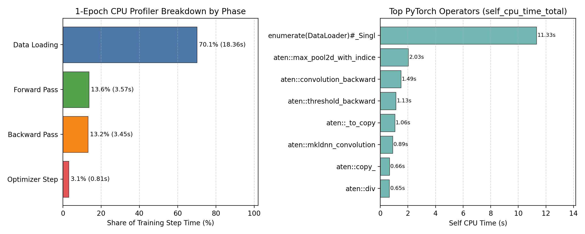
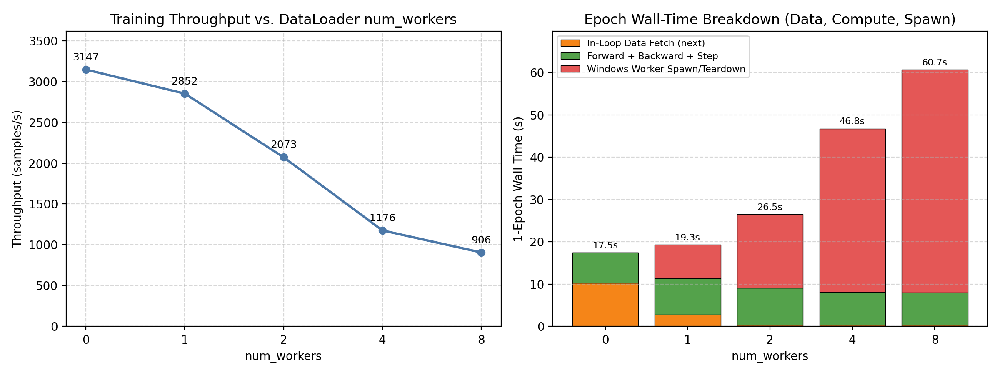
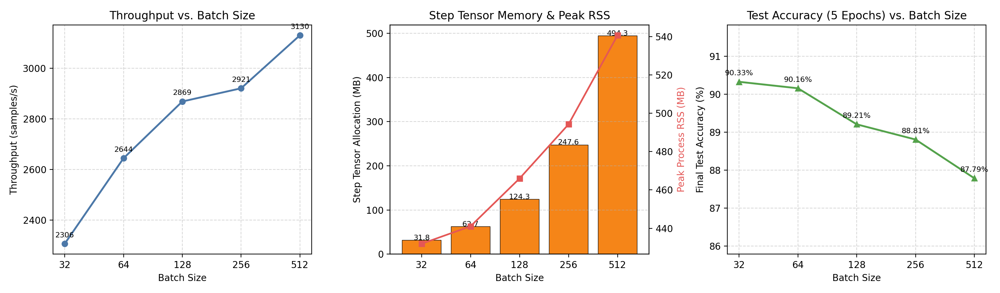
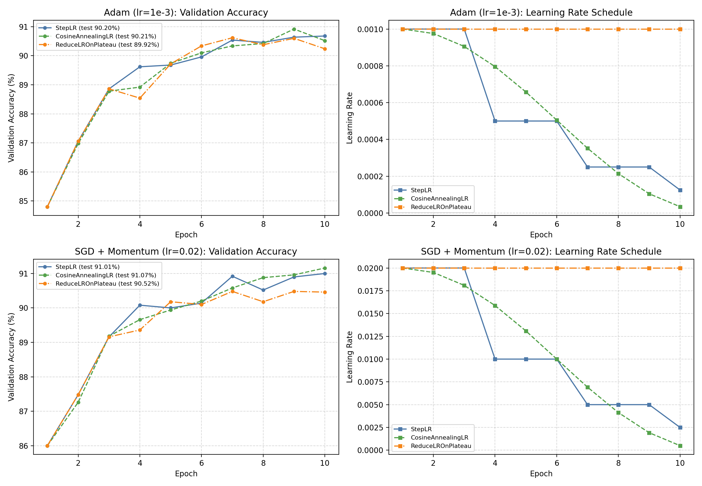
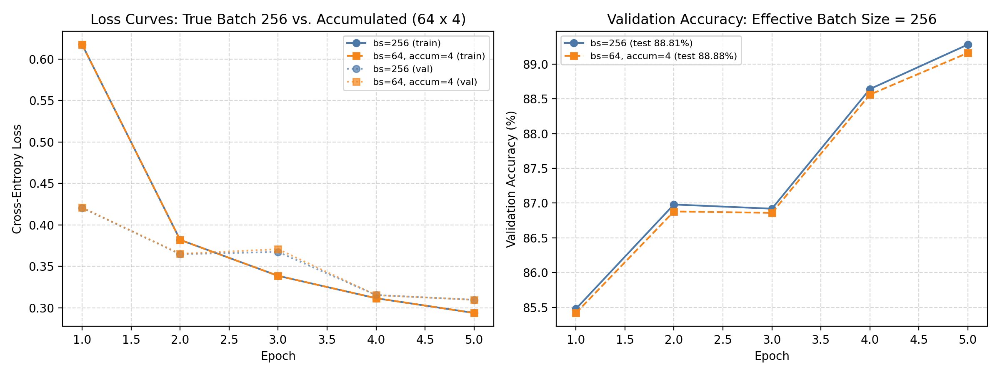
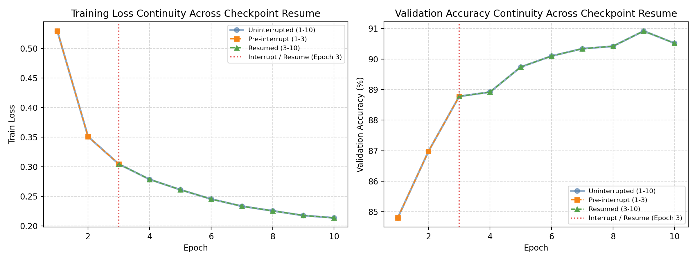

# Lab 6: Training Pipelines and Project Proposal

**Student:** Mykyta Yevchuk (ID: 73369)  
**Environment:** Windows x86-64 CPU (`12` logical cores, `6` PyTorch intra-op threads, MKL-DNN enabled, `16.39 GB` RAM), `torch==2.3.1+cpu`, `mlflow==2.14.1`

---

## 1. YAML-Driven Training Pipeline & MLflow Tracking (Task 1)

The best model from Lab 3—the 2-block **`CNN`** (`20,490` parameters: `Conv2d(1,16,3) -> ReLU -> MaxPool2d(2) -> Conv2d(16,32,3) -> ReLU -> MaxPool2d(2) -> Flatten -> Linear(1568,10)`) on **FashionMNIST** (`55,000` train / `5,000` validation / `10,000` test)—was restructured into a single YAML-driven training script:
- **Configuration**: [`lab06/config.yaml`](file:///c:/Users/nikit/Documents/repo/lab06/config.yaml) holds all dataset, model, seed, optimizer, scheduler, gradient accumulation, checkpoint, profiling, and MLflow settings in one object loaded by [`load_config`](file:///c:/Users/nikit/Documents/repo/lab06/src/train.py) and passed to [`run_training`](file:///c:/Users/nikit/Documents/repo/lab06/src/train.py).
- **Reproducibility**: Deterministic seeding (`random`, `numpy`, `torch`, `random_split` generator, and `DataLoader` shuffle generator) ensures identical data splits and batch ordering across runs.
- **Checkpointing**: [`save_checkpoint`](file:///c:/Users/nikit/Documents/repo/lab06/src/train.py) persists `epoch`, `model_state_dict`, `optimizer_state_dict`, `scheduler_state_dict`, `best_val_acc`, `history`, `rng_states`, and `config` to both `*_best.pt` and `*_last.pt`.
- **MLflow Tracking**: All runs log flattened YAML parameters, per-epoch metrics (`train_loss`, `train_acc`, `val_loss`, `val_acc`, `lr`, `epoch_time_s`, `throughput_samples_s`), summary system metrics (`avg_throughput_samples_s`, `peak_rss_mb`, `step_tensor_mem_mb`, `test_acc`, `test_loss`), and artifacts (resolved YAML config, `history.json`, best checkpoint, and profiler summaries) under `lab06/mlruns/` (see [`mlflow_runs_summary.json`](file:///c:/Users/nikit/Documents/repo/lab06/results/mlflow_runs_summary.json)).

---

## 2. One-Epoch Profiling with `torch.profiler` (Task 2)

One training epoch (`55,000` samples, `batch_size=128`, `430` steps, `num_workers=0`) was profiled with `torch.profiler.profile(activities=[ProfilerActivity.CPU], record_shapes=True, profile_memory=True)` using `record_function` markers around the four pipeline stages ([`profiler_breakdown.json`](file:///c:/Users/nikit/Documents/repo/lab06/results/profiler_breakdown.json)).

| Training Phase | Profiled CPU Time (ms) | Share of Step Time (%) |
| :--- | ---: | ---: |
| **Data Loading** (`next(data_iter)`) | 18,362.93 | **70.12%** |
| **Forward Pass** (`model(x)` + loss) | 3,570.82 | **13.63%** |
| **Backward Pass** (`loss.backward()`) | 3,445.39 | **13.16%** |
| **Optimizer Step** (`step()` + `zero_grad()`) | 809.57 | **3.09%** |
| **Total Profiled Step CPU Time** | **26,188.71** | **100.00%** |

**Key Takeaways:**
- **Data-pipeline bound**: Over **70%** of CPU execution time is spent inside `DataLoader` (`enumerate(DataLoader)#_SingleProcessDataLoaderIter.__next__`: `11.33 s` self CPU, `18.35 s` total CPU), executing `55,000` individual PIL-to-tensor conversions (`ToTensor` + `Normalize` triggering `398,336` `aten::to` and `176,610` `aten::_to_copy` calls).
- **Compute breakdown**: Within the remaining ~30% compute time, the top kernels are `aten::max_pool2d_with_indices` (`2.03 s`), `aten::convolution_backward` (`1.49 s`), `aten::threshold_backward` (`1.13 s`), and `aten::mkldnn_convolution` (`0.89 s`).
- *Instrumentation overhead note*: Enabling `record_shapes=True` and `profile_memory=True` across all `430` batches (~hundreds of thousands of tiny per-sample ops) increased wall-clock epoch time to `645.18 s` (`85.25 samples/s`), demonstrating why production profiling uses short `schedule(wait, warmup, active)` windows rather than full-epoch memory tracing.

---

## 3. DataLoader `num_workers` Study & Bottleneck Analysis (Task 3)

Varying `num_workers` across `[0, 1, 2, 4, 8]` for 1 epoch (`batch_size=128`, `seed=42`) produced identical model metrics (`train_loss=0.5295`, `val_acc=84.80%`) with stark wall-time differences ([`num_workers_study.json`](file:///c:/Users/nikit/Documents/repo/lab06/results/num_workers_study.json)):

| `num_workers` | Epoch Wall Time (s) | In-Loop Data Fetch (s) | Compute Time (s) | Spawn / Teardown Overhead (s) | Throughput (samples/s) | Peak RSS (MB) |
| :---: | ---: | ---: | ---: | ---: | ---: | ---: |
| **0** | **17.48** | 10.25 (58.63%) | 7.19 | 0.04 | **3,146.69** | 448.75 |
| **1** | 19.28 | 2.79 (14.48%) | 8.52 | 7.97 | 2,852.23 | 494.02 |
| **2** | 26.53 | 0.32 (1.19%) | 8.81 | 17.40 | 2,073.16 | 489.82 |
| **4** | 46.76 | 0.29 (0.62%) | 7.78 | 38.69 | 1,176.26 | 467.04 |
| **8** | 60.70 | 0.27 (0.44%) | 7.68 | 52.75 | 906.03 | 468.51 |

**Bottleneck Analysis:**
- At `num_workers=0`, training is **data-loading bound** on the main thread (`10.25 s` data vs `7.19 s` compute).
- Moving to `num_workers=2..8` successfully overlaps batch preparation, collapsing in-loop `next(data_iter)` wait time from `10.25 s` to `0.27 s`.
- **Why throughput degrades instead of improving**: On Windows, multiprocessing uses `spawn` rather than `fork`. Each epoch without `persistent_workers=True` spawns `num_workers` fresh Python processes that each re-import `torch` and `torchvision`. Because the CNN compute per epoch is small (`~7.7 s`), worker startup and IPC teardown (`7.97 s` at `1` worker up to `52.75 s` at `8` workers) dwarfs the `~10 s` data-loading savings, reducing overall throughput by **3.47×** from `3,146.69` (`num_workers=0`) down to `906.03 samples/s` (`num_workers=8`).

---

## 4. Batch-Size Study (Task 4)

Trained for **5 epochs** (`Adam`, `lr=1e-3`, `seed=42`, `num_workers=0`) across batch sizes `[32, 64, 128, 256, 512]` ([`batch_size_study.json`](file:///c:/Users/nikit/Documents/repo/lab06/results/batch_size_study.json)):

| Batch Size | Updates / Epoch | Avg Throughput (samples/s) | Step Tensor Alloc (MB) | Peak RSS (MB) | Total 5-Ep Time (s) | Final Val Acc | Final Test Acc |
| :---: | ---: | ---: | ---: | ---: | ---: | ---: | ---: |
| **32** | 1,719 | 2,306.01 | 31.84 | 431.93 | 119.88 | 90.14% | **90.33%** |
| **64** | 860 | 2,644.13 | 62.67 | 441.04 | 104.07 | **90.48%** | 90.16% |
| **128** | 430 | 2,868.66 | 124.33 | 465.97 | 95.87 | 89.72% | 89.21% |
| **256** | 215 | 2,920.87 | 247.64 | 494.23 | 94.47 | 89.28% | 88.81% |
| **512** | 108 | **3,130.46** | 494.26 | 540.66 | **88.09** | 88.14% | 87.79% |

**Trade-off Analysis:**
- **Throughput**: Scales from `2,306.0` (`bs=32`) to `3,130.5 samples/s` (`bs=512`, **+35.8%**) by amortizing Python dispatch and optimizer steps (`1,719` → `108` steps/epoch) and improving MKL-DNN SIMD vector utilization.
- **Memory**: Per-step tensor allocations scale **linearly** with batch size (`31.84 MB` → `494.26 MB`, ~2× per doubling), raising peak process RSS from `431.93 MB` to `540.66 MB`.
- **Generalization / Epoch Budget**: Under a fixed 5-epoch budget and unscaled learning rate (`1e-3`), test accuracy drops from `90.33%` (`bs=32`) to `87.79%` (`bs=512`) because `bs=512` performs `16×` fewer gradient updates (`540` vs `8,595` total steps) and exhibits lower gradient noise.

---

## 5. Learning-Rate Schedules & Optimizer Comparison (Task 5)

Evaluated `StepLR(step_size=3, gamma=0.5)`, `CosineAnnealingLR(T_max=10, eta_min=1e-5)`, and `ReduceLROnPlateau(factor=0.5, patience=2)` across `Adam(lr=1e-3)` and `SGD+Momentum(lr=0.02, momentum=0.9)` under equal **10-epoch** budgets (`batch_size=128`, `seed=42`, [`lr_opt_comparison.json`](file:///c:/Users/nikit/Documents/repo/lab06/results/lr_opt_comparison.json)):

| Optimizer | Scheduler | Final LR | Final Train Acc | Final Val Acc | Best Val Acc | Final Test Acc |
| :--- | :--- | ---: | ---: | ---: | ---: | ---: |
| **Adam** (`lr=1e-3`) | `StepLR` | 0.000125 | 92.33% | 90.68% | 90.68% | 90.20% |
| **Adam** (`lr=1e-3`) | `CosineAnnealingLR` | 0.000034 | 92.49% | 90.52% | 90.92% | 90.21% |
| **Adam** (`lr=1e-3`) | `ReduceLROnPlateau` | 0.001000 | 92.59% | 90.24% | 90.62% | 89.92% |
| **SGD + Momentum** (`lr=0.02, m=0.9`) | `StepLR` | 0.002500 | 93.00% | 91.00% | 91.00% | 91.01% |
| **SGD + Momentum** (`lr=0.02, m=0.9`) | `CosineAnnealingLR` | 0.000499 | **93.31%** | **91.16%** | **91.16%** | **91.07%** |
| **SGD + Momentum** (`lr=0.02, m=0.9`) | `ReduceLROnPlateau` | 0.020000 | 92.77% | 90.46% | 90.48% | 90.52% |

**Observations:**
- **SGD+Momentum vs. Adam**: Well-tuned `SGD+Momentum` (`lr=0.02, m=0.9`) consistently beat `Adam` (`lr=1e-3`) by **+0.60% to +0.86% test accuracy** across all three schedules (`91.07%` vs `90.21%` best), aligning with vision CNN literature where momentum SGD generalizes slightly better than adaptive diagonal scaling.
- **Schedulers**: `CosineAnnealingLR` achieved the highest test accuracy for both optimizers (`91.07%` SGD, `90.21%` Adam) by smoothly annealing the learning rate down to fine-tune weights in epochs 7–10. `ReduceLROnPlateau(patience=2)` never triggered within 10 epochs because validation loss continued setting slight new lows every 1–2 epochs, leaving LR at its initial value and causing slightly noisier final epochs.

---

## 6. Gradient Accumulation (Task 6)

Emulated effective batch size **256** (`5` epochs, `Adam lr=1e-3`, `seed=42`) using micro-batch `64` and `grad_accum_steps=4` with loss scaled by `1 / 4` prior to `backward()` ([`grad_accum_study.json`](file:///c:/Users/nikit/Documents/repo/lab06/results/grad_accum_study.json)):

| Configuration | Effective Batch | Epoch 1 Train Loss | Epoch 5 Train Loss | Final Val Acc | Final Test Acc | Avg Throughput (samples/s) | Step Tensor Alloc (MB) |
| :--- | :---: | ---: | ---: | ---: | ---: | ---: | ---: |
| `bs=256, accum=1` | 256 | 0.6175 | 0.2937 | 89.28% | 88.81% | **3,046.63** | 247.64 |
| `bs=64, accum=4` | 256 | 0.6175 | 0.2936 | 89.16% | **88.88%** | 2,642.99 | **62.67** (**3.95× lower**) |

Training and validation trajectories match closely across all 5 epochs (final train loss `0.2937` vs `0.2936`, test accuracy `88.81%` vs `88.88%`) while reducing per-step tensor activation memory by **~4×** (`247.64 MB` → `62.67 MB`), at a modest ~13% throughput trade-off due to smaller micro-batch vectorization.

---

## 7. Checkpoint Interruption & Resume Verification (Task 7)

Trained `CNN` for 10 epochs (`batch_size=128`, `Adam`, `CosineAnnealingLR(T_max=10)`, `seed=42`) in two configurations ([`resume_study.json`](file:///c:/Users/nikit/Documents/repo/lab06/results/resume_study.json)):
1. **Uninterrupted baseline** (epochs 1–10).
2. **Interrupted after epoch 3**, saved to `task7_interrupted_ep3_last.pt` (weights, Adam moments, `CosineAnnealingLR` state, history, and RNG states), then **resumed** for epochs 4–10.

| Epoch | Uninterrupted Train Loss | Resumed Train Loss | Uninterrupted Val Acc | Resumed Val Acc | Learning Rate |
| :---: | ---: | ---: | ---: | ---: | ---: |
| 3 (Interrupt) | 0.304764 | 0.304764 | 88.78% | 88.78% | 0.000905 |
| 4 (Resume) | 0.278858 | 0.278858 | 88.92% | 88.92% | 0.000796 |
| 7 | 0.233574 | 0.233574 | 90.34% | 90.34% | 0.000352 |
| 10 (Final) | 0.213836 | 0.213836 | 90.52% | 90.52% | 0.000034 |

Both runs converge smoothly to the exact same final **Test Accuracy of `90.21%`**, confirming fault-tolerant, deterministic checkpoint recovery.

---

## 8. Individual Project Proposal (Task 8)

The one-page individual project proposal for **Mykyta Yevchuk (ID: 73369)** is documented in [`lab06/proposal.md`](file:///c:/Users/nikit/Documents/repo/lab06/proposal.md), targeting CIFAR-10 edge deployment ($\le 50\text{ ms}$ latency, $\le 5\text{ MB}$ size) via **Knowledge Distillation** and **Post-Training Static INT8 Quantization**.
