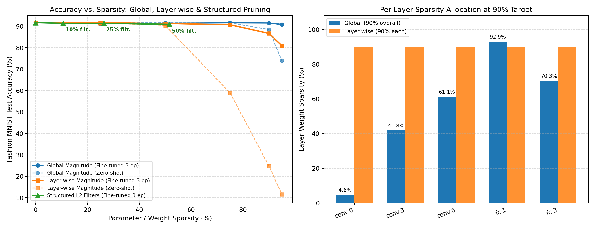
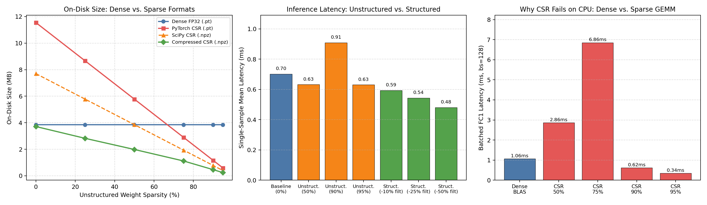
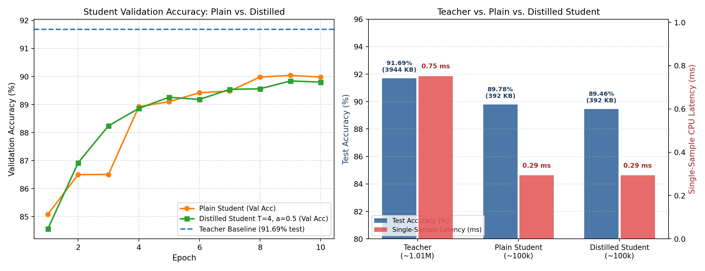

# Lab 7: Compression — Pruning and Distillation

**Student:** Mykyta Yevchuk (ID: 73369)  
**Environment:** Windows x86-64 CPU (`6` PyTorch intra-op threads, `15.27 GB` RAM), `torch==2.3.1+cpu`, `scipy==1.13.1`, `thop==0.1.1`, `codecarbon==2.4.2`  
**Config & Runner:** [`lab07/config.yaml`](file:///c:/Users/nikit/Documents/repo/lab07/config.yaml), [`lab07/src/experiments.py`](file:///c:/Users/nikit/Documents/repo/lab07/src/experiments.py)

---

## 1. Oversized Baseline CNN on Fashion-MNIST (Task 1)

An oversized 3-block CNN ([`OversizedCNN`](file:///c:/Users/nikit/Documents/repo/lab07/src/models.py#L25-L60)) was trained for **10 epochs** on Fashion-MNIST (`55,000` train / `5,000` val / `10,000` test, `batch_size=256`, `Adam(lr=1e-3, weight_decay=1e-4)`, `CosineAnnealingLR`, `seed=42`, [`baseline_metrics.json`](file:///c:/Users/nikit/Documents/repo/lab07/results/baseline_metrics.json)):

- **Architecture**: `Conv2d(1,24,3) -> ReLU -> MaxPool2d(2) -> Conv2d(24,48,3) -> ReLU -> MaxPool2d(2) -> Conv2d(48,160,3) -> ReLU -> MaxPool2d(2) -> Flatten -> Linear(1440,640) -> ReLU -> Linear(640,10)`
- **Total Parameters**: **`1,008,586`** (~1.01M; `1,007,704` prunable weights in Conv/Linear layers, `882` biases)
- **Dense Compute**: **`6,516,352` MACs** (`13.03M` FLOPs) per `1×28×28` image
- **On-Disk Size**: **`3.85 MB`** (`4,038,454` bytes dense FP32 `.pt`)
- **Accuracy**: `94.98%` final train accuracy, **`91.94%`** best validation accuracy, **`91.69%`** test accuracy
- **CPU Inference Latency**: **`0.808 ms`** mean (`0.781 ms` p50) at `batch_size=1`; **`21.77 ms`** mean (`5,880 samples/s`) at `batch_size=128`

---

## 2. Magnitude Pruning & Structured Filter Pruning (Task 2)

### 2.1 Unstructured Magnitude Pruning (Global vs. Layer-wise)
Weights across all `Conv2d` and `Linear` layers were ranked by `|w|` and masked at sparsity targets `[0, 0.25, 0.5, 0.75, 0.9, 0.95]` both **globally** and **per layer** ([`build_magnitude_masks`](file:///c:/Users/nikit/Documents/repo/lab07/src/pruning.py#L43-L82)), then fine-tuned for **3 epochs** (`Adam(lr=3e-4)`) with the binary masks strictly frozen ([`pruning_results.json`](file:///c:/Users/nikit/Documents/repo/lab07/results/pruning_results.json)):

| Target Sparsity | Non-zero Weights | Global Zero-Shot Acc | Global Fine-Tuned Acc | Layer-wise Zero-Shot Acc | Layer-wise Fine-Tuned Acc |
| :---: | ---: | ---: | ---: | ---: | ---: |
| **0%** (Baseline) | 1,007,704 | 91.69% | **91.69%** | 91.69% | **91.69%** |
| **25%** | 755,778 | 91.69% | 91.13% | 91.47% | **91.78%** |
| **50%** | 503,852 | 91.70% | **91.43%** | 90.42% | 91.28% |
| **75%** | 251,926 | 91.56% | **91.62%** | 58.93% | 90.68% |
| **90%** | 100,770 | 88.48% | **91.54%** | 24.84% | 86.72% |
| **95%** | 50,385 | 73.91% | **90.79%** | 11.61% | 80.96% |

### 2.2 Structured L2 Filter Pruning
Whole `Conv2d` output filters were ranked by L2 norm `||W_out||_2` and physically removed at `[10%, 25%, 50%]` ([`structured_prune_filters`](file:///c:/Users/nikit/Documents/repo/lab07/src/pruning.py#L145-L202)), rebuilding a smaller dense `OversizedCNN` (slicing downstream Conv input channels and flattened `fc.1` columns) and fine-tuning for **3 epochs**:

| Filter Pruned | Surviving Channels | Total Params | Param Sparsity | Dense MACs | Zero-Shot Acc | Fine-Tuned Acc |
| :---: | :---: | ---: | ---: | ---: | ---: | ---: |
| **0%** (Baseline) | `(24, 48, 160)` | 1,008,586 | 0.00% | 6,516,352 | 91.69% | **91.69%** |
| **10%** | `(22, 43, 144)` | 901,139 | 10.65% | 5,390,488 | 90.05% | **91.41%** |
| **25%** | `(18, 36, 120)` | 743,298 | 26.30% | 3,872,800 | 87.29% | **91.40%** |
| **50%** | `(12, 24, 80)` | 487,946 | 51.62% | 1,906,624 | 79.16% | **90.84%** |

**Analysis:**
- **Global vs. Layer-wise at High Sparsity**: At `90%` sparsity, global pruning holds **`91.54%`** (`-0.15%` vs. baseline) while layer-wise drops to **`86.72%`** (`-4.97%`), and at `95%` the gap widens to **`90.79%` vs. `80.96%`**. As shown in the right panel, global pruning preserves critical early edge filters (`conv.0` only `4.6%` pruned, `conv.3` `41.8%`) while aggressively pruning the over-parameterized `fc.1` layer (`92.9%` pruned). Layer-wise pruning forces `conv.0` (`216` weights total) to lose `90–95%` of its weights, destroying low-level feature extraction.
- **Structured Filter Pruning**: Removing `50%` of Conv filters cuts total parameters by **`51.62%`** and MACs by **`70.7%`** (`6.52M` → `1.91M`), recovering from `79.16%` zero-shot to **`90.84%`** (`-0.85%`) in 3 epochs.

---

## 3. Latency & Dense vs. Sparse Storage Analysis (Task 3)

All pruned variants were benchmarked on CPU (`batch_size=1` over 400 runs after 50 warmup; `batch_size=128` over 60 runs after 15 warmup) and serialized in both dense and CSR sparse formats ([`latency_storage_results.json`](file:///c:/Users/nikit/Documents/repo/lab07/results/latency_storage_results.json)):

### 3.1 On-Disk Size & Full-Model CPU Latency

| Variant | Dense `.pt` (MB) | PyTorch CSR `.pt` (MB) | SciPy CSR `.npz` (MB) | Compressed CSR `.npz` (MB) | Single `p50` / `mean` (ms) | Batch-128 Mean (ms) | Throughput (img/s) |
| :--- | ---: | ---: | ---: | ---: | ---: | ---: | ---: |
| **Unstructured 0%** | 3.85 | 11.55 | 7.70 | 3.71 | 0.691 / 0.702 | 22.67 | 5,646 |
| **Unstructured 25%** | 3.85 | 8.67 | 5.78 | 2.82 | 0.827 / 3.278* | 21.09 | 6,069 |
| **Unstructured 50%** | 3.85 | 5.78 | 3.86 | 1.99 | 0.624 / 0.632 | 22.97 | 5,573 |
| **Unstructured 75%** | 3.85 | 2.90 | 1.94 | 1.12 | 0.623 / 0.638 | 23.61 | 5,422 |
| **Unstructured 90%** | 3.85 | 1.17 | 0.78 | **0.47** | 0.828 / 0.910 | 21.14 | 6,056 |
| **Unstructured 95%** | 3.85 | 0.59 | 0.40 | **0.24** | 0.622 / 0.630 | 23.31 | 5,490 |
| **Structured -10% Filt.** | 3.44 | — | — | — | 0.583 / 0.594 | 19.37 | 6,609 |
| **Structured -25% Filt.** | 2.84 | — | — | — | 0.516 / 0.543 | 17.32 | 7,390 |
| **Structured -50% Filt.** | **1.87** | — | — | — | **0.426 / 0.481** | **10.06** | **12,718** |

*\*OS scheduling jitter spike in `p95=20.16 ms`; median `p50=0.827 ms`.*

### 3.2 Dense BLAS vs. Sparse CSR Kernel Microbenchmark (`fc.1`: `1440 → 640`)

| Kernel | Sparsity | Single-Sample (`bs=1`) | Speedup vs. Dense | Batched (`bs=128`) | Speedup vs. Dense |
| :--- | :---: | ---: | ---: | ---: | ---: |
| `dense_blas` (`F.linear`) | 0% | 0.131 ms | 1.00× | 1.065 ms | 1.00× |
| `torch_sparse_csr` | 50% | 0.628 ms | **0.21×** (4.8× slower) | 2.861 ms | **0.37×** (2.7× slower) |
| `torch_sparse_csr` | 75% | 0.265 ms | **0.49×** (2.0× slower) | 6.857 ms | **0.16×** (6.4× slower) |
| `torch_sparse_csr` | 90% | 0.135 ms | **0.97×** | 0.615 ms | 1.73× |
| `torch_sparse_csr` | 95% | 0.090 ms | 1.45× | 0.343 ms | 3.10× |

**Why Unstructured Sparsity Rarely Speeds Up Dense CPU Kernels:**
1. **Dense Storage & Execution**: Saving a masked model in standard `.pt` format stores all `1.01M` FP32 values (`3.85 MB`) regardless of zeros, and dense CPU kernels (`oneDNN`/`MKL-DNN`) multiply every element including zeros (`21.1–23.6 ms` batched latency across `0%–95%` sparsity).
2. **CSR Metadata Overhead on Disk**: Uncompressed CSR stores `data` (FP32) + `indices` (`int32` in SciPy, `int64` in PyTorch CSR) + `indptr`. Below **`50%`** sparsity, `SciPy CSR .npz` (`3.86 MB`) and `PyTorch CSR .pt` (`5.78 MB`) are **larger** than dense FP32 (`3.85 MB`); sparse storage only wins above `~50–75%` sparsity (reaching `0.24 MB` compressed at `95%` sparsity).
3. **Why Sparse CSR Kernels Lag on CPU**: Dense BLAS/MKL-DNN achieves near-peak FLOP/s via contiguous memory streaming, AVX2/AVX-512 SIMD vectorization, and L1/L2 cache blocking. In contrast, CSR SpMM (`fc.1` microbenchmark) performs **indirect indexed loads** (`x[col_idx[k]]`), breaks SIMD vectorization, suffers cache misses, and adds loop-control overhead—making CSR **2.7×–6.4× slower** than dense BLAS at `50%–75%` sparsity and barely breaking even at `90%` (`0.97×` single-sample). Only **structured pruning** (`-50%` filters) shrinks tensor dimensions directly, yielding a real **`2.25×`** batched speedup (`22.67 ms` → `10.06 ms`).

---

## 4. Knowledge Distillation (Task 4)

A compact **`StudentCNN`** ([`StudentCNN`](file:///c:/Users/nikit/Documents/repo/lab07/src/models.py#L63-L94): `Conv2d(1,16,3) -> Pool -> Conv2d(16,32,3) -> Pool -> Linear(1568,60) -> Linear(60,10)`, **`99,550` parameters** = `10.13×` smaller than Teacher) was trained for **10 epochs** (`Adam(lr=1e-3, wd=1e-4)`, `CosineAnnealingLR`, `seed=42`) both **without** Teacher (plain Cross-Entropy) and **with** the frozen `OversizedCNN` Teacher using $T=4.0, \alpha=0.5$ ([`distillation_results.json`](file:///c:/Users/nikit/Documents/repo/lab07/results/distillation_results.json)):

$$\mathcal{L}_{\text{KD}} = \alpha\,\text{CE}(z_s, y) + (1 - \alpha)\,T^2\,\text{KL}\!\left(\text{softmax}(z_t/T)\,\|\,\text{softmax}(z_s/T)\right)$$

| Model | Params | Dense Size | MACs | Best Val Acc | Test Acc | Single Latency (ms) | Throughput (img/s) |
| :--- | ---: | ---: | ---: | ---: | ---: | ---: | ---: |
| **Teacher (`OversizedCNN`)** | 1,008,586 | 3.85 MB | 6.52M | 91.94% | **91.69%** | 0.751 | 6,026 |
| **Plain Student (`StudentCNN`)** | 99,550 | **0.38 MB** | 1.11M | **90.04%** | **89.78%** | **0.293** | 14,387 |
| **Distilled Student (`T=4, α=0.5`)** | 99,550 | **0.38 MB** | 1.11M | 89.84% | 89.46% | **0.293** | **14,522** |

**Plain vs. Distilled Student Analysis:**
- Both `99.6k`-parameter students achieve a **`10.1×` size reduction** (`3.85 MB` → `0.38 MB`), **`5.87×` MAC reduction** (`6.52M` → `1.11M`), and **`2.56×` single-sample speedup** (`0.751 ms` → `0.293 ms`) relative to the Teacher, at ~`1.9–2.2%` lower test accuracy.
- **Why Distillation Did Not Beat the Plain Student Here**: Under an equal 10-epoch budget with `T=4, alpha=0.5`, the Distilled Student (`89.46%`) trailed the Plain Student (`89.78%`) by `-0.32%`. Two factors explain this: (1) on Fashion-MNIST, a `100k`-parameter CNN already has sufficient capacity for the task, leaving a modest `1.91%` Teacher–Student gap; and (2) the Teacher has `94.98%` training accuracy vs. `91.69%` test accuracy, so its soft logits on the training set are sharp/overconfident while the $T^2 = 16$ KL weighting (`0.5 * CE + 8 * KL`) slows early hard-label fitting (`train_acc` `91.10%` vs. `91.55%` at epoch 10).

---

## 5. Summary by Reddi Ch. 9 Efficiency Pillars & Conclusion (Task 5)

| Model Variant | **Data** Pillar | **Model** Pillar (Params / Dense → Comp. Size / Test Acc) | **Compute** Pillar (Theor. → Exec. MACs / Latency / Thru.) | **Energy** Pillar (`CodeCarbon` J / 10k imgs) |
| :--- | :--- | :--- | :--- | ---: |
| **Baseline Oversized CNN** | 55k/5k/10k Fashion-MNIST (FP32) | 1,008,586 / 3.85 → 3.71 MB / **91.69%** | 6.52M → 6.52M MACs / 0.808 ms / 5,880 img/s | 80.82 J |
| **Unstructured Global (90%)** | + 3 ep mask-fixed fine-tune | 100,770 nz (1.01M tot) / 3.85 → **0.47 MB** / **91.54%** | 0.65M → **6.52M** MACs / 0.910 ms / 6,056 img/s | 96.94 J |
| **Structured L2 (-50% Filters)** | + 3 ep dense fine-tune | 487,946 / **1.87** → 1.80 MB / **90.84%** | 1.91M → **1.91M** MACs / 0.481 ms / 12,718 img/s | 39.47 J |
| **Plain Student (~100k)** | Hard labels only (CE, 10 ep) | **99,550** / **0.38** → 0.37 MB / **89.78%** | 1.11M → **1.11M** MACs / **0.293 ms** / 14,387 img/s | 32.52 J |
| **Distilled Student (~100k)** | Hard labels + Teacher soft logits | **99,550** / **0.38** → 0.37 MB / 89.46% | 1.11M → **1.11M** MACs / **0.293 ms** / **14,522 img/s** | **31.72 J** |

### Conclusion
1. **Storage vs. Latency Decoupling**: Global unstructured magnitude pruning is exceptional for **storage compression** (`90%` sparsity retains `91.54%` accuracy and shrinks compressed CSR size by **`8.2×`** to `0.47 MB`), but delivers **zero CPU speedup or energy savings** (`96.94 J` vs. `80.82 J`) because dense CPU kernels still execute all `6.52M` MACs and naive CSR kernels suffer indirect-indexing overhead.
2. **Real Hardware Efficiency**: **Structured pruning** (`-50%` filters) and **compact student architectures** (`~100k` params) reduce executed MACs directly, cutting CPU inference energy by **`2.05×`** (`39.47 J`) and **`2.55×`** (`31.72 J`) respectively while increasing throughput up to **`2.47×`** (`14,522 img/s`).
3. **Practical Recommendation**: Use **global unstructured pruning** when disk/flash footprint is the sole constraint, **structured filter pruning** when preserving `>90.8%` accuracy with `2×` CPU speedup/energy reduction, and **compact architectures** (with distillation tuned via lower $T$ / higher $\alpha$ when a larger teacher–student capacity gap exists) for strict edge latency and energy budgets.
